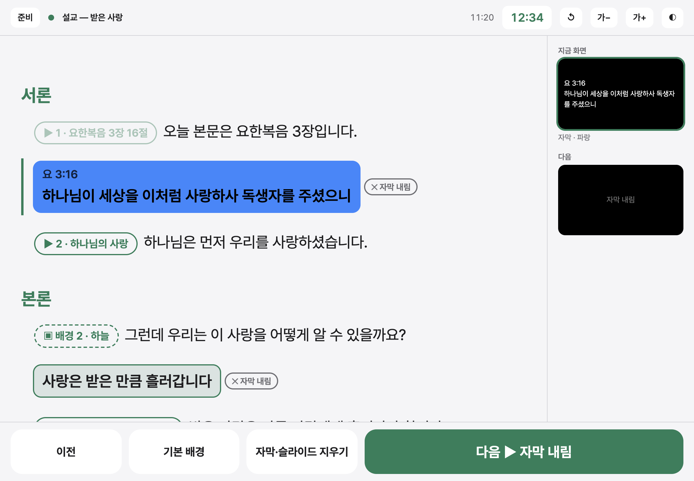
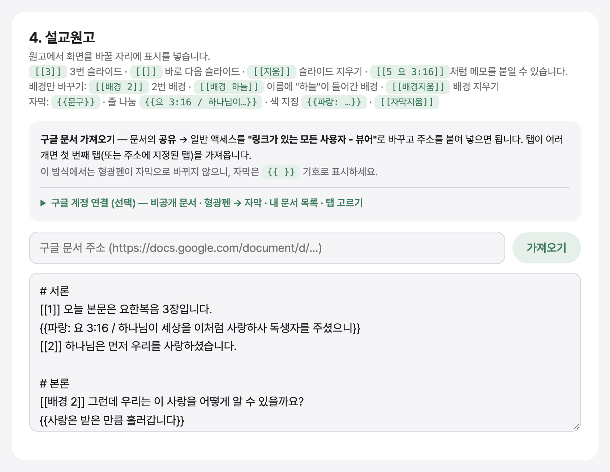

# 설교 리모컨 (propresenter-sermon-remote)

강단의 아이패드에서 **설교원고를 보면서** 방송실 맥의 **ProPresenter** 슬라이드·배경·자막을 함께 넘기는 프로그램입니다.

- 원고 속 표시(`[[3]]`, `{{요 3:16 / 하나님이…}}`)가 그대로 버튼이 됩니다. "다음"만 눌러도 원고 순서대로 넘어갑니다.
- 구글 문서 원고를 주소로 바로 가져옵니다. (선택: 구글 계정을 연결하면 형광펜 칠한 문구가 자막 버튼이 됩니다)
- 슬라이드를 따로 만들지 않아도, 원고의 문구를 ProPresenter **메시지**로 바로 자막처럼 띄웁니다.
- (선택) **유튜브 방송용 자막**을 무대와 다른 디자인으로 OBS에 함께 띄웁니다.
- 맥 한 대에서 켜 두고, 같은 와이파이의 아이패드 사파리로 접속합니다. 따로 설치할 앱이 없습니다.

<p align="center"></p>

> 화면 사진은 모두 예시 자료로 찍었습니다.

> **지원 환경**: macOS 11 이상 + ProPresenter (Network 기능 사용, 만든 사람은 21.2·22.0.1에서 시험).
> 윈도우는 지원하지 않습니다.

## 빠르게 시작하기 (dmg 앱)

1. 오른쪽 **Releases**에서 `propresenter-sermon-remote-<버전>.dmg`를 내려받아 엽니다.
2. **설교 리모컨** 아이콘을 **Applications** 폴더로 끌어다 놓습니다.
3. ProPresenter → 설정 → **Network** → **Enable Network**를 켜고 Port 번호를 적어 둡니다.
4. 응용 프로그램의 **설교 리모컨**을 엽니다. 처음에는 경고가 나옵니다 → [처음 열기](docs/설치-안내.md#1-앱-처음-열기).
5. 브라우저에 준비 화면이 열리고, 맨 위에 **아이패드 접속 주소**와 **비밀번호 6자리**가 보입니다. 아이패드 사파리에서 그 주소를 엽니다.

Node.js가 앱 안에 들어 있어서 따로 설치할 것이 없습니다.
아이패드 홈 화면이나 맥 Dock에 추가하면 브라우저 없이 앱처럼 열 수 있습니다 → [앱처럼 쓰기](docs/설치-안내.md#앱처럼-쓰기-선택).
애플 개발자 인증을 받지 않은 무료 프로그램이라, 처음 한 번은 "그래도 열기"를 눌러야 합니다.

> dmg 대신 소스 폴더로 쓰려면: [Node.js](https://nodejs.org) LTS 설치 → **Code** → **Download ZIP** → 폴더의 `start.command` 더블클릭.

자세한 순서는 아래 안내서를 차례대로 보세요.

| 안내서 | 내용 |
|---|---|
| [설치 안내](docs/설치-안내.md) | Node 설치, 실행, 아이패드 접속, 매주 쓰는 순서 |
| [ProPresenter 준비](docs/ProPresenter-준비.md) | 자막 틀(메시지)·테마 만드는 법, 좌우 배치, 꼭 알아야 할 주의점 |
| [구글 계정 연결](docs/구글-계정-연결.md) | (선택) 비공개 문서·형광펜 자막을 쓰려면 |
| [유튜브 자막 (OBS)](docs/유튜브-자막-OBS.md) | (선택) 유튜브 방송에 무대와 다른 모양의 자막을 겹치려면 |
| [문제 해결](docs/문제-해결.md) | 접속이 안 될 때, 자주 나오는 오류 문구 |

## 원고에 넣는 표시

| 표시 | 뜻 |
|---|---|
| `[[3]]` | 3번 슬라이드 띄우기 |
| `[[]]` | 바로 다음 번호 슬라이드 |
| `[[5 요 3:16]]` | 5번 슬라이드 + 메모(화면에는 안 나감) |
| `[[지움]]` | 슬라이드 지우기 (배경은 남음) |
| `[[배경 2]]` | 2번 배경만 바꾸기 (슬라이드는 그대로) |
| `[[배경 하늘]]` | 이름에 "하늘"이 들어간 배경 |
| `[[배경지움]]` | 배경 지우기 |
| `{{문구}}` | 문구를 자막으로 띄우기 |
| `{{요 3:16 / 하나님이 세상을…}}` | 두 줄 자막 (첫 줄은 주소, 나머지는 본문) |
| `{{파랑: …}}` | 파랑으로 정한 자막 틀로 띄우기 |
| `[[자막지움]]` | 자막 내리기 |

- 색 이름: 노랑·초록·하늘·파랑·보라·분홍·빨강·주황. 색을 안 쓰면 "기본" 틀로 뜹니다.
- `# 제목` 또는 구글 문서의 제목 스타일은 소제목으로 보입니다.
- 빨간 테두리 버튼은 "그 번호의 슬라이드가 없다" 또는 "그 색의 자막 틀이 정해지지 않았다"는 뜻입니다.
- 자막 버튼 뒤에는 "✕ 자막 내림" 버튼이 자동으로 붙습니다.
- 유튜브 자막(OBS)을 켜면 자막이 유튜브에도 함께 뜹니다. 틀을 정하지 않은 색은 유튜브에만 뜹니다. → [유튜브 자막 (OBS)](docs/유튜브-자막-OBS.md)

### 예시



```
# 서론
[[1]] 오늘 본문은 요한복음 3장입니다.
{{파랑: 요 3:16 / 하나님이 세상을 이처럼 사랑하사…}}
[[배경 2]] 그런데 우리는 이 사랑을 어떻게 알 수 있을까요?
{{사랑은 받은 만큼 흘러갑니다}}
```

## 보안과 개인 정보

- 서버는 **같은 네트워크 안에서만** 쓰도록 만들었습니다. 공유기에서 포트를 열어(포트 포워딩) 인터넷에 내놓지 마세요.
- 접속은 암호화되지 않은 `http`입니다. 카페·학교 같은 공용 와이파이에서는 쓰지 마세요. 교회 내부망이나 휴대폰 핫스팟을 권장합니다.
- OBS 자막 주소(`/overlay?key=…`)를 아는 사람은 자막 화면을 볼 수 있습니다(바꿀 수는 없음). 방송 담당에게만 알려 주세요.
- 비밀번호를 아는 기기는 화면을 넘기고, 연결된 구글 계정의 문서 목록과 내용을 볼 수 있습니다. 함께 쓰는 사람에게만 알려 주세요.
- 다음 파일에는 비밀번호 해시, 구글 연결 정보, 원고가 저장됩니다. **남에게 주거나 깃허브에 올리지 마세요.** (`.gitignore`에 들어 있습니다)
  `auth.json` · `google.json` · `state.json` · `config.json` · `overlay.json`(OBS 자막 주소의 키) · `overlay-media/`(유튜브 자막 배경)
  - dmg 앱: `~/Library/Application Support/설교 리모컨/` 폴더
  - `start.command`: 프로그램 폴더
- 프로그램을 다른 맥으로 옮길 때도 위 파일은 빼고 옮긴 뒤 새로 설정하는 것이 안전합니다.

## 글꼴

화면은 [Pretendard](https://github.com/orioncactus/pretendard)로 보입니다(인터넷 연결 시 자동).
인터넷이 없는 곳에서도 쓰려면 `PretendardVariable.woff2`를 `public/fonts/` 폴더에 넣으세요.

## dmg 만들기 (개발자용)

- 맥에서 `bash scripts/build-dmg.sh` → `dist/` 폴더에 dmg가 생깁니다. Node.js(애플 실리콘·인텔용)를 내려받아 앱에 넣습니다.
- 깃허브에서는 `v1.0.0`처럼 `v`로 시작하는 태그를 올리면 [자동 빌드](.github/workflows/build-dmg.yml)가 dmg를 만들어 Releases에 붙입니다.
- 버전 번호는 `server.js`의 `VERSION` 한 곳에서 바꿉니다.
- 앱 안의 Node.js는 [MIT 라이선스](https://github.com/nodejs/node/blob/main/LICENSE)이며, 원문을 앱 안 `node-LICENSE`로 함께 넣습니다.

## 라이선스

[PolyForm Noncommercial 1.0.0](LICENSE) — **비영리 목적이면 누구나 무료로** 쓰고 고치고 나눌 수 있습니다.
교회·선교단체·학교 같은 비영리 단체와 개인의 사역·공부에 쓰는 것은 괜찮습니다.
이 프로그램을 **팔거나, 유료 서비스·상품에 넣는 것은 허락되지 않습니다.** 그런 용도라면 먼저 연락해 주세요.

다른 사람에게 나눌 때는 `LICENSE` 파일과 `Required Notice` 줄을 함께 넣어 주세요.

ProPresenter는 Renewed Vision의 상표이며, 이 프로그램은 Renewed Vision과 관계가 없습니다.

Copyright 2026 조성훈 (JO SUNGHUN)
