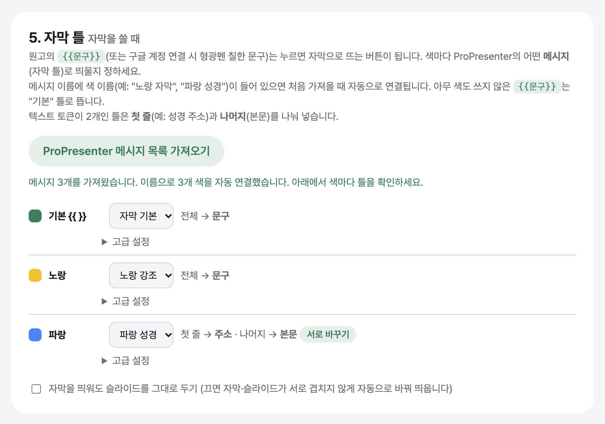
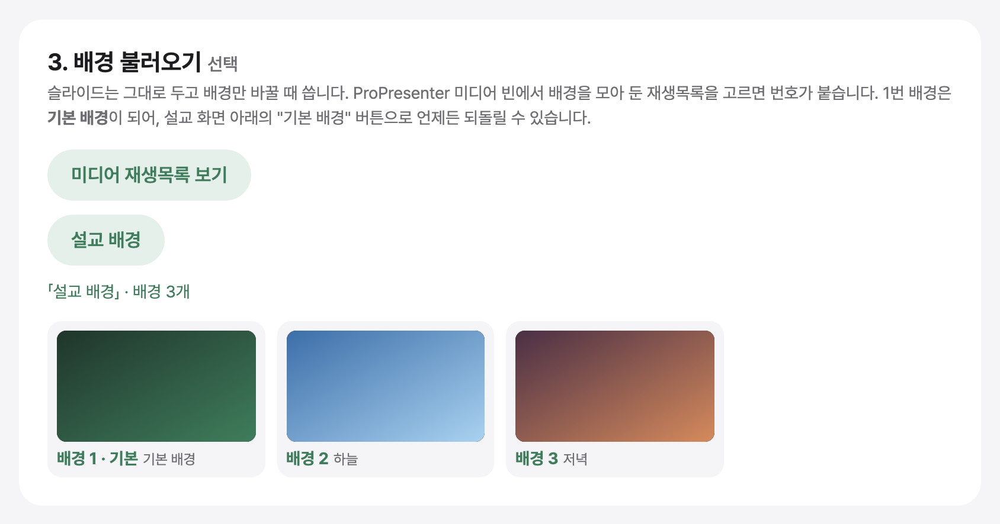

# ProPresenter 준비

설교 리모컨은 ProPresenter에 이미 있는 것(프레젠테이션·미디어·메시지)을 **불러와서 누르기만** 합니다.
그래서 화면에 어떻게 보일지는 모두 ProPresenter 쪽에서 정합니다. 이 문서는 그 준비 방법입니다.

| 쓰고 싶은 것 | ProPresenter에서 준비할 것 |
|---|---|
| 설교 슬라이드 `[[3]]` | 평소처럼 프레젠테이션을 만들어 재생목록이나 라이브러리에 둡니다 |
| 배경 바꾸기 `[[배경 2]]` | 미디어 빈에 **재생목록** 하나를 만들고 배경 영상·사진을 넣습니다 (1번 = 기본 배경) |
| 자막 `{{문구}}` | **메시지**(자막 틀)를 만듭니다 ↓ |

---

## 1. 자막 틀 만들기 — 기본 (하단 자막 한 줄)

대부분의 교회는 이것 하나면 충분합니다.

### ① 테마(모양) 만들기
1. ProPresenter → **테마**(Theme) 편집 화면에서 새 테마를 만듭니다.
2. 슬라이드 크기를 **출력 화면 해상도와 똑같이** 맞춥니다. (예: 1920×1080, LED는 3840×2160 등)
3. 배경은 비워 둡니다(투명). 자막만 위에 얹히게 하기 위해서입니다.
4. 화면 아래쪽에 글상자를 하나 두고:
   - **글꼴은 한글이 들어 있는 글꼴로** 정합니다. (예: Pretendard, Apple SD Gothic Neo, 나눔고딕) → 아래 "주의 2" 참고
   - 정렬, 크기, 색, 그림자를 정합니다. 밝은 배경 위에서도 읽히도록 그림자를 넣는 것을 권합니다.

### ② 메시지 만들기
1. ProPresenter → **메시지** 창 → **+** 로 새 메시지를 만듭니다. 이름 예: `노랑 자막`
2. 테마는 ①에서 만든 테마를 고릅니다.
3. 메시지 글자 칸에 **토큰 추가…** → 이름(예: `문구`)을 입력하고 **Enter**. 글자 칸에는 이 토큰 하나만 둡니다.

### ③ 설교 리모컨에서 연결
1. 준비 화면 **5. 자막 틀** → **ProPresenter 메시지 목록 가져오기**.
2. 메시지 이름에 색 이름이 들어 있으면(예: `노랑 자막`) **자동으로 연결**됩니다. 아니면 색 옆 목록에서 직접 고릅니다.

   

3. 원고에 `{{노랑: 오늘의 핵심 문장}}`, 또는 색 없이 `{{오늘의 핵심 문장}}`(→ "기본" 틀)을 쓰면 끝입니다.

> 이름 자동 연결 규칙: 색 이름(노랑·초록·하늘·파랑·보라·분홍·빨강·주황)이 들어간 메시지는 그 색으로,
> 색 이름 없이 "자막"이나 "기본"이 들어간 메시지는 "기본"으로 연결됩니다. 이미 고른 색은 바꾸지 않습니다.

## 2. 성경 구절 틀 (주소 + 본문)

원고에 `{{파랑: 요 3:16 / 하나님이 세상을 이처럼 사랑하사…}}`처럼 쓰면 첫 줄은 주소, 나머지는 본문입니다.

**방법 A — 메시지 하나, 토큰 두 개** (간단)
- 메시지 하나에 토큰 `주소`와 `본문` 두 개를 넣습니다. 설교 리모컨이 첫 줄은 첫 토큰, 나머지는 둘째 토큰에 넣습니다.
  순서가 반대로 들어가면 5번 카드의 **서로 바꾸기**를 누르세요.
- 단, 메시지 하나는 **글상자 서식 하나만** 따릅니다. 주소와 본문을 다른 크기·색으로 할 수 없습니다.

**방법 B — 메시지 두 개** (주소를 작은 노란 글씨처럼 따로 꾸미고 싶을 때)
- `파랑 성경 본문`(토큰 `본문`)과 `성경 주소`(토큰 `주소`) 메시지를 따로 만들고, 각각 다른 테마 슬라이드(서식)를 씁니다.
- 5번 카드에서 파랑 = `파랑 성경 본문`, **고급 설정** → **첫 줄만 다른 틀로** = `성경 주소`.
- 버튼 하나로 두 메시지가 함께 뜹니다.

## 3. 좌우 배치 (선택 — 설교자가 화면 가운데 서는 무대)

LED 벽 가운데에 설교자가 서서 가운데를 비우고 **왼쪽·오른쪽에 같은 글자**를 띄우고 싶을 때만 필요합니다.

- **슬라이드**: 테마 슬라이드에 글상자를 **복사해서 두 개**(왼쪽·오른쪽) 둡니다.
- **자막(메시지)**: 메시지를 **두 개**(`자막 왼쪽`, `자막 오른쪽`) 만들고, 각각 왼쪽 상자만 있는 테마 / 오른쪽 상자만 있는 테마를 씁니다.
  5번 카드에서 그 색의 틀 = `자막 왼쪽`, **고급 설정** → **같은 글자를 함께 띄울 틀** = `자막 오른쪽`. 버튼 하나로 양쪽이 동시에 뜹니다.

---

## 배경 불러오기 (선택)

미디어 빈에 배경을 모아 둔 재생목록을 만들면, 준비 화면 **3. 배경 불러오기**에서 번호가 붙습니다. 원고에 `[[배경 2]]`처럼 씁니다.

## 꼭 알아야 할 주의점 (시험하면서 겪은 것)

**주의 1. "링크된 텍스트"는 믿지 마세요.**
오른쪽 상자를 왼쪽 상자의 "링크된 텍스트"로 만들면 편해 보이지만, 메시지에서는 가운데 정렬이 무시되고 왼쪽으로 붙었고,
슬라이드 출력에서는 글자 크기가 달라진 적이 있습니다. 좌우에 같은 글자가 필요하면 위 3번처럼 **상자 복사** 또는 **메시지 두 개**를 쓰세요.

**주의 2. 한글 글꼴을 직접 지정하세요.**
Helvetica Neue처럼 한글이 없는 글꼴을 두면 ProPresenter가 다른 글꼴로 대신 그리면서 좌우 굵기가 달라졌습니다. Pretendard Bold로 바꾸니 해결됐습니다.

**주의 3. 메시지를 복제하면 토큰이 깨집니다.**
복제한 메시지에 `${…긴 영문…}` 같은 글자가 그대로 나오면, 글자 칸을 지우고 **토큰 추가…**로 토큰을 다시 넣으세요.

**주의 4. 자막이 바뀔 때의 효과(페이드)는 메시지 레이어 공통 설정입니다.**
메시지마다 따로 정할 수 없습니다. 0.3초 정도의 디졸브를 권합니다.

**주의 5. 자막과 슬라이드가 겹치지 않게.**
기본으로, 자막을 띄우면 슬라이드를 내리고 슬라이드를 띄우면 자막을 내립니다.
둘 다 동시에 보이게 하려면 5번 카드 아래의 **"자막을 띄워도 슬라이드를 그대로 두기"** 를 켜세요.

**주의 6. 다른 맥으로 옮길 때 (ProPresenter 설정 → Sync)**
- **Themes**는 테마 전부를, **Support Files**는 메시지·화면 구성·룩까지 한꺼번에 옮깁니다. 받는 맥의 출력 설정을 덮어쓸 수 있으니 조심하세요.
- **Replace My Files**는 끄고 옮기는 것이 안전합니다.
- 옮긴 뒤에는 설교 리모컨 5번 카드에서 **메시지 목록 가져오기**를 다시 누르세요. (맥이 바뀌면 메시지 고유 번호가 달라질 수 있습니다)

**주의 7. 테마 슬라이드 순서를 바꿔도** 메시지와 테마의 연결은 유지되었습니다.

**참고. 편집 창을 열어 둬도 됩니다.** ProPresenter 22.0.1에서 슬라이드 편집 화면을 열어 둔 채로 슬라이드·양쪽 자막·성경 주소/본문·배경·지우기를 모두 시험했고, 정상으로 바뀌었습니다.
