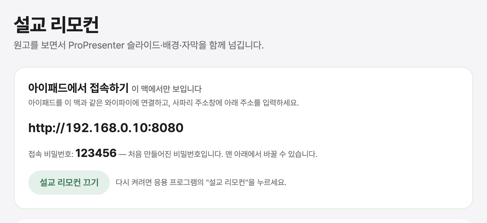
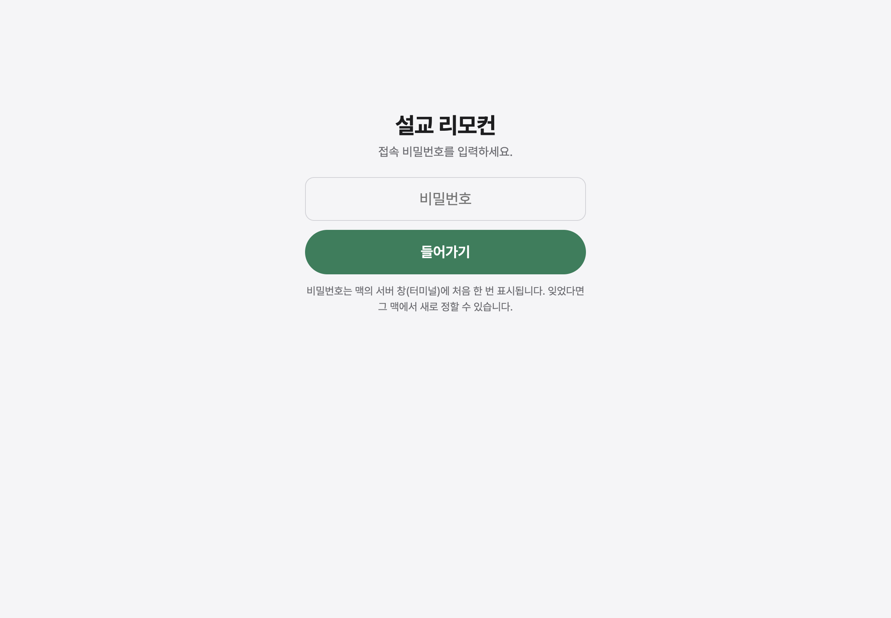
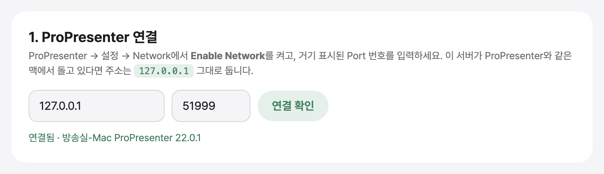
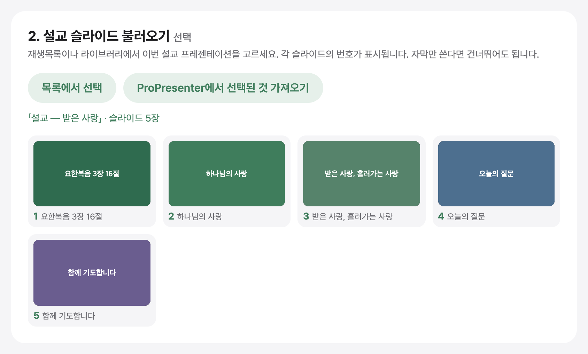
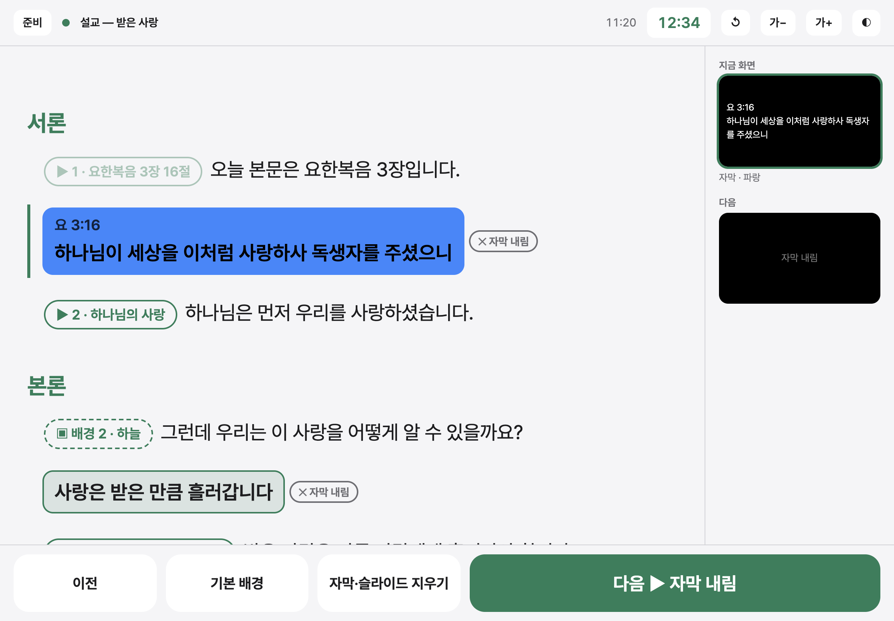
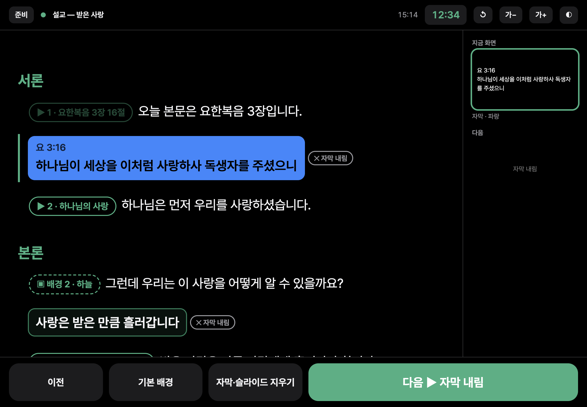

# 설치 안내

방송실 맥(ProPresenter가 켜진 맥)에 한 번 설치하고, 매주 강단의 아이패드로 접속해서 씁니다.

설치 방법은 두 가지입니다. **보통은 A(dmg 앱)** 를 쓰세요.

- **A. dmg 앱** — 내려받아 끌어다 놓기만 하면 됩니다. 아래 "A" 부분만 보세요.
- **B. 소스 폴더 + start.command** — Node.js를 직접 설치하고 폴더로 씁니다. 아래 "B" 부분을 보세요.

---

# A. dmg 앱으로 설치

## 1. 앱 처음 열기

1. 깃허브 저장소의 **Releases**에서 `propresenter-sermon-remote-<버전>.dmg`를 내려받아 더블클릭합니다.
2. 열린 창에서 **설교 리모컨** 아이콘을 옆의 **Applications** 폴더로 끌어다 놓습니다.
3. **응용 프로그램** 폴더(Finder 왼쪽)에서 **설교 리모컨**을 더블클릭합니다.
4. **"확인할 수 없습니다"** 경고가 나오면 (개발자 인증을 받지 않은 무료 프로그램이라 처음 한 번 나옵니다):
   - 경고 창에서 **완료**를 누르고,
   - **시스템 설정** → **개인정보 보호 및 보안** → 아래로 내려서 "설교 리모컨이(가) 차단되었습니다" 옆 **그래도 열기** → 맥 비밀번호,
   - 다시 **설교 리모컨**을 더블클릭 → **열기**.
5. "node이(가) 들어오는 네트워크 연결을 허용하겠습니까?" → **허용**. (아이패드 접속에 필요합니다)
   "로컬 네트워크의 기기를 찾고 연결하도록 허용" → **허용**.

켜지면 **브라우저에 준비 화면**이 열립니다. Dock에는 아이콘이 보이지 않지만 뒤에서 켜져 있습니다.

## 2. 아이패드 접속 주소와 비밀번호

준비 화면 맨 위 **"아이패드에서 접속하기"** 카드에 주소(예: `http://192.168.0.10:8080`)와 처음 비밀번호 6자리가 보입니다.


아래 **B의 4번(ProPresenter 네트워크 켜기)** 과 **5번(아이패드에서 접속)** 부터 이어서 보세요.

## 3. 끄기와 다시 켜기

- 끄기: 준비 화면 맨 위의 **설교 리모컨 끄기**.
- 다시 켜기: 응용 프로그램의 **설교 리모컨**을 다시 엽니다. 이미 켜져 있으면 준비 화면만 다시 열립니다.
- 준비 화면 창을 닫아도 서버는 계속 켜져 있습니다.
- 맥을 켤 때 저절로 켜지게 하려면: 시스템 설정 → 일반 → **로그인 항목** → **+** → 설교 리모컨.

설정·비밀번호·원고는 `~/Library/Application Support/설교 리모컨/` 폴더에 저장됩니다. 앱을 새 버전으로 바꿔도 그대로 남습니다.

---

# B. 소스 폴더 + start.command

준비물
- ProPresenter가 설치된 **맥** (랜선 연결 권장)
- 강단에서 쓸 **아이패드** (같은 와이파이에 연결)
- 인터넷 (처음 설치할 때)

---

## 1. Node.js 설치 (처음 한 번)

설교 리모컨은 Node.js라는 프로그램 위에서 돌아갑니다.

1. 맥에서 사파리로 https://nodejs.org 를 엽니다.
2. **LTS**라고 적힌 큰 버튼을 눌러 내려받습니다. (`.pkg` 파일)
3. 내려받은 파일을 더블클릭 → **계속** → **동의** → **설치** → 맥 비밀번호 입력 → **닫기**.

이미 설치되어 있는지 모르겠다면 그냥 4단계로 가세요. 없으면 `start.command`가 알려 줍니다.

## 2. 프로그램 내려받기

1. 이 저장소의 깃허브 페이지에서 초록색 **Code** 버튼 → **Download ZIP**.
2. 다운로드 폴더의 zip을 더블클릭해서 풉니다.
3. 풀린 폴더(`propresenter-sermon-remote-main`)를 원하는 곳으로 옮깁니다. 예: **응용 프로그램** 또는 **문서** 폴더.
   이름을 `설교 리모컨`처럼 바꿔도 됩니다.

> 폴더 안에 나중에 비밀번호·설정 파일이 저장됩니다. 다운로드 폴더처럼 자주 정리하는 곳은 피하세요.

## 3. start.command 처음 열기

1. 폴더 안의 **`start.command`** 를 더블클릭합니다.
2. **"확인되지 않은 개발자"** 또는 **"열 수 없습니다"** 경고가 나오면:
   - 경고 창에서 **완료**(또는 취소)를 누르고,
   - 맥의 **시스템 설정** → **개인정보 보호 및 보안** → 아래쪽의 "`start.command`이(가) 차단되었습니다" 옆 **그래도 열기** → 맥 비밀번호.
   - 다시 `start.command`를 더블클릭 → **열기**.
   - (예전 macOS에서는 `start.command`를 **Control 키를 누른 채 클릭** → **열기**로도 됩니다.)
3. **"권한이 없습니다"** 라고 나오면 실행 권한이 빠진 것입니다. 터미널을 열고 아래를 입력한 뒤 Enter:
   ```
   chmod +x 
   ```
   (끝에 띄어쓰기 한 칸 → `start.command` 파일을 터미널 창으로 끌어다 놓기 → Enter)
4. 터미널 창이 열리고 이런 글자가 나오면 성공입니다.
   ```
   설교 리모컨 v1.0.0 서버가 켜졌습니다.
   아이패드 사파리에서 아래 주소로 접속하세요:

      http://192.168.0.10:8080

   접속 비밀번호: 482913
   ```
   **접속 비밀번호는 처음 한 번만 나옵니다.** 적어 두세요. (잊어도 다시 정할 수 있습니다 → 6번)

이 터미널 창을 닫으면 프로그램도 꺼집니다. 예배 중에는 창을 열어 두세요.

## 4. ProPresenter 네트워크 켜기 (처음 한 번)

1. ProPresenter → 메뉴 막대의 **ProPresenter** → **설정**(Settings).
2. **Network** 탭 → **Enable Network** 켜기.
3. 옆에 나온 **Port** 번호를 적어 둡니다. (예: 1025)

## 5. 아이패드에서 접속

1. 아이패드가 맥과 **같은 와이파이**에 연결되어 있는지 확인합니다.
2. 사파리 주소창에 터미널에 나온 주소(예: `http://192.168.0.10:8080`)를 입력합니다.
3. 접속 비밀번호를 입력 → **들어가기**. (90일 동안 다시 묻지 않습니다)

   

4. 사파리 **공유 버튼** → **홈 화면에 추가**를 하면 앱처럼 전체 화면으로 열립니다.
5. 아이패드 **설정** → **디스플레이 및 밝기** → **자동 잠금** → **안 함**.

> 주소가 여러 줄 나오면 보통 `192.168.`이나 `10.`으로 시작하는 것이 맞습니다.
> 접속이 안 되면 [문제 해결](문제-해결.md#아이패드에서-접속이-안-돼요)을 보세요.

## 6. 준비 화면 설정 (처음 한 번 + 매주 조금)

아이패드(또는 맥)에서 열면 **준비 화면**이 나옵니다.

| 카드 | 처음 한 번 | 매주 |
|---|---|---|
| 1. ProPresenter 연결 | 포트 번호 입력 → **연결 확인** | — |
| 2. 설교 슬라이드 | — | **목록에서 선택** → 이번 주 프레젠테이션 |
| 3. 배경 (선택) | 배경 재생목록 고르기 | — |
| 4. 설교원고 | — | 구글 문서 주소 붙여 넣기 → **가져오기** |
| 5. 자막 틀 | 색마다 메시지 고르기 ([ProPresenter 준비](ProPresenter-준비.md)) | — |





다 됐으면 **설교 화면 열기**.

**접속 비밀번호 바꾸기**: 맥에서 사파리로 `http://localhost:8080`을 열면 비밀번호 없이 들어가고, 준비 화면 맨 아래에 "접속 비밀번호" 카드가 보입니다. (아이패드에서는 보이지 않습니다)

## 7. 설교 화면



- 아래 **다음 ▶** 을 누르면 원고 순서대로 슬라이드·배경·자막이 넘어갑니다. 원고 속 버튼을 직접 눌러도 됩니다.
- **이전**, **기본 배경**(배경 1번으로), **자막·슬라이드 지우기**.
- 위쪽: **준비**(준비 화면으로), 연결 상태 점(초록 = 정상), 타이머(누르면 멈춤/시작, ↺ 초기화), 글자 크기 **가− 가+**, 어두운 화면 **◐**.
- 오른쪽: 지금 화면과 다음 화면 미리보기 (아이패드를 가로로 둘 때).

어두운 화면(◐)으로 바꾼 모습:



## 매주 쓰는 순서 (요약)

1. 맥: ProPresenter 켜기 → **설교 리모컨** 앱 열기 (B 방식이면 `start.command` 더블클릭)
2. 아이패드: 홈 화면의 설교 리모컨 열기
3. 준비 화면: 2번 프레젠테이션 고르기, 4번 원고 가져오기
4. **설교 화면 열기**
5. 예배가 끝나면 준비 화면의 **설교 리모컨 끄기** (B 방식이면 터미널 창 닫기)

> 비상용으로 ProPresenter Remote 앱이나 클리커를 함께 준비해 두세요.
